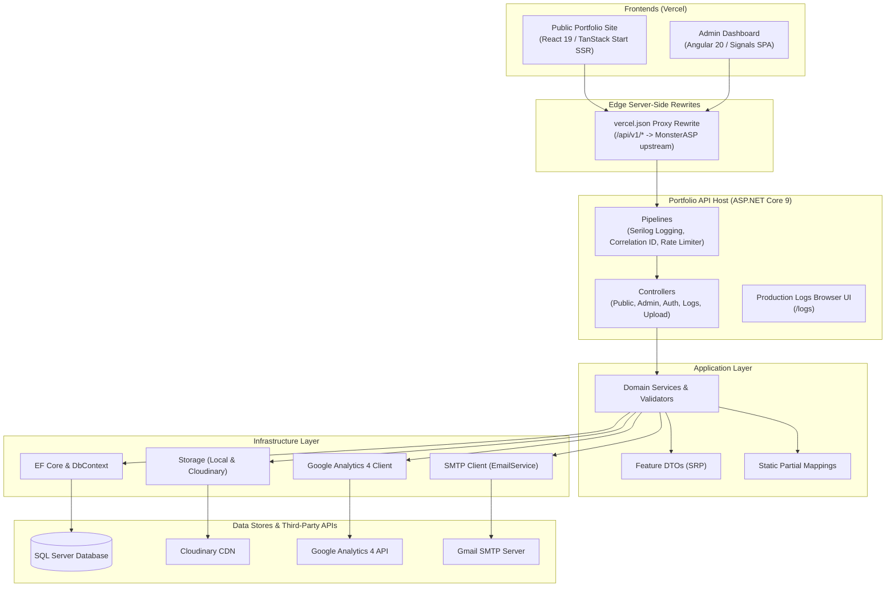

# Portfolio — Full-Stack Ecosystem

<p align="center">
  
  
  
  
  
  
  
</p>

An enterprise-grade personal portfolio platform engineered around a centralized, Clean Architecture REST API, an administrative control center, and a public-facing SSR web application.

Three independently deployable systems share a single unified backend:
1. **Public Portfolio Site** (`portfolio/`) — Server-rendered platform built with React 19, TanStack Start & Nitro.
2. **Admin Dashboard** (`dashboard/`) — Operations management panel built with Angular 20 Standalone Components & Signals.
3. **Portfolio API** (`PortfolioAPI/`) — High-performance REST service built on ASP.NET Core 9, Entity Framework Core, and SQL Server.

---

## 🌐 Live Deployments

| Surface | URL | Environment / Host | Status |
| :--- | :--- | :--- | :--- |
| **Public Portfolio** | [portfolio-market.vercel.app](https://portfolio-market.vercel.app) | Vercel (Edge / SSR) | Active |
| **Admin Dashboard** | [dashboard-portfolio-ms.vercel.app](https://dashboard-portfolio-ms.vercel.app) | Vercel (SPA) | Active |
| **Portfolio API** | [portfolio-market.runasp.net](http://portfolio-market.runasp.net) | MonsterASP.NET (IIS) | Active |
| **Swagger UI** | [portfolio-market.runasp.net/swagger](http://portfolio-market.runasp.net/swagger) | ASP.NET Core Swagger | Active |
| **Production Logs UI** | [portfolio-market.runasp.net/logs](http://portfolio-market.runasp.net/logs) | Portfolio Diagnostics | Active |

> [!NOTE]
> Frontends communicate with the API via same-origin `/api` server-side proxy rewrites in their respective `vercel.json` configurations. This eliminates CORS overhead and prevents mixed-content restrictions. Neither frontend ever falls back to stale bundled fixtures if the API is offline — lists render intentional empty/error states and detail routes return 404.

---

## 🏗️ Architecture & Data Flow



---

## 📁 Repository Layout

```text
.
├── Portfolio.sln              # Master Visual Studio solution (.NET 9)
├── README.md                  # Ecosystem overview (this file)
├── CONTRIBUTING.md            # Contributor guide, setup & PR workflow
├── SECURITY.md                # Vulnerability disclosure & security policies
├── ACCESSIBILITY.md           # WCAG 2.1 AA accessibility guidelines
├── LICENSE.txt                # MIT license
│
├── docs/                      # Central engineering & architecture documentation
│   ├── BACK_STRUCTURE.md      # Authoritative Clean Architecture backend specification
│   ├── BRANCH_STRATEGY.md     # Git branch taxonomy, conventional commits & release flow
│   ├── API_VERSIONING.md      # URL-segment versioning (/api/v1/) and deprecation rules
│   ├── DEPLOYMENT.md          # Production deployment guide (MonsterASP.NET + Vercel)
│   ├── STORAGE.md             # Dual-provider media storage pipeline (Local + Cloudinary)
│   ├── DASHBOARD_AUDIT.md     # Frontend audit log and design decisions
│   └── FULL_STRUCTURE.md      # Monorepo directory map
│
├── PortfolioAPI/              # Backend service (ASP.NET Core 9 Clean Architecture)
│   ├── src/
│   │   ├── PortfolioAPI/                # API host: controllers, auth, middleware, Program.cs
│   │   ├── PortfolioAPI.Core/           # Pure domain entities, repository contracts, Results
│   │   ├── PortfolioAPI.Application/    # Feature DTOs (SRP), partial mappings, services, validators
│   │   └── PortfolioAPI.Infrastructure/ # DbContext, SQL Server configs, SMTP, Cloudinary, GA4
│   └── tests/
│       ├── PortfolioAPI.UnitTests/        # 246 passing unit tests (runs in CI)
│       └── PortfolioAPI.IntegrationTests/ # MsSql Testcontainers integration suite
│
├── dashboard/                 # Admin operations dashboard (Angular 20 SPA)
└── portfolio/                 # Public portfolio platform (React 19 / TanStack Start SSR)
```

---

## ⚡ Quick Start

### Prerequisites
- **.NET SDK 9.0+**
- **Node.js 22+** (recommended) or **20+**
- **SQL Server** (LocalDB, SQL Express, or Docker container)

### 1. Backend Service (`:5039`)
```bash
# Apply EF Core migrations to local database
dotnet ef database update --project PortfolioAPI/src/PortfolioAPI.Infrastructure --startup-project PortfolioAPI/src/PortfolioAPI

# Launch Web API
dotnet run --project PortfolioAPI/src/PortfolioAPI/PortfolioAPI.csproj
```
- API Base: `http://localhost:5039`
- Swagger UI: `http://localhost:5039/swagger`
- Interactive Logs UI: `http://localhost:5039/logs`

### 2. Admin Dashboard (`:4200`)
```bash
cd dashboard
npm ci
npm run dev
```
Serves on `http://localhost:4200`. The development proxy forwards all `/api` calls directly to `:5039`.

### 3. Public Portfolio Site (`:5173`)
```bash
cd portfolio
npm ci
npm run dev
```
Serves on `http://localhost:5173`.

---

## 🚀 Key Architectural Features

- **Clean Architecture & SRP**: Strict inward dependency flow. DTOs are isolated per feature (1 class per file); mappings are compiled partial extensions without reflection overhead.
- **Interactive Production Logs Browser**: Dedicated HTML viewer at `/logs` and API at `/api/v1/logs/*` for real-time telemetry, log level filtering, and log file streaming downloads.
- **Google Analytics 4 Integration**: Outbound GA4 Data API client delivering real-time user metrics, page views, geographical breakdowns, and device distribution to the admin panel.
- **Multi-Website Registry**: Ability to tag projects and content to distinct frontend website targets across the ecosystem.
- **Enterprise Serilog Logging**: Structured JSON rolling log sinks, W3C distributed tracing context, and HTTP correlation tracking.
- **Dual-Provider Media Pipeline**: Transparent image upload validation, decompression-bomb protection, and delivery supporting local filesystem in dev and Cloudinary CDN in production.
- **Public & Admin Rate Limiting**: Token-bucket and sliding-window rate limiters guarding public contact forms and administrative login routes.

---

## 📡 Core API Surface (`/api/v1/`)

| Endpoint | Method | Access | Notes |
| :--- | :--- | :--- | :--- |
| `/api/v1/public/projects` | `GET` | Anonymous (Cached) | Active published projects filtered by website or category |
| `/api/v1/public/skills` | `GET` | Anonymous (Cached) | Categorized active skills |
| `/api/v1/public/credentials` | `GET` | Anonymous (Cached) | Work experience, degrees, and certifications |
| `/api/v1/public/categories` | `GET` | Anonymous (Cached) | Filter taxonomy chips |
| `/api/v1/public/websites` | `GET` | Anonymous (Cached) | Registered portfolio website entities |
| `/api/v1/public/contact` | `POST` | Anonymous (Rate-limited) | Public inquiry form submission with email notification |
| `/api/v1/auth/login` | `POST` | Anonymous (Rate-limited) | Authenticates credentials and returns signed JWT token |
| `/api/v1/projects` | `CRUD` | Bearer JWT (Admin) | Full project management, tags, and media links |
| `/api/v1/skills` | `CRUD` | Bearer JWT (Admin) | Skills matrix, proficiency levels, and icon mappings |
| `/api/v1/experience` | `CRUD` | Bearer JWT (Admin) | Career history timeline management |
| `/api/v1/contact` | `GET`/`PUT`/`DELETE` | Bearer JWT (Admin) | Inbox management, mark-as-read, thread replies |
| `/api/v1/upload` | `POST` | Bearer JWT (Admin) | Multipart image upload (JPEG, PNG, WebP up to 10 MiB) |
| `/api/v1/analytics/overview` | `GET` | Bearer JWT (Admin) | Real-time and historical Google Analytics 4 summary |
| `/api/v1/logs/info` | `GET` | Bearer JWT (Admin) | Active log file metrics, sizes, and line counts |
| `/api/v1/logs/entries` | `GET` | Bearer JWT (Admin) | Filtered log query search by level and search string |
| `/api/v1/logs/download` | `GET` | Bearer JWT (Admin) | Direct raw log file streaming download |
| `/api/v1/health` | `GET` | Anonymous | Readiness probe (runtime + SQL Server connectivity) |

---

## 🧪 Testing & CI Verification

```bash
# Run backend unit tests (246 tests, runs in GitHub Actions CI)
dotnet test PortfolioAPI/tests/PortfolioAPI.UnitTests/PortfolioAPI.UnitTests.csproj

# Run Angular dashboard production build
cmd /c "npm run build" # inside dashboard/

# Run public portfolio SSR build
npm run build # inside portfolio/
```

Our continuous integration workflow ([.github/workflows/ci.yml](.github/workflows/ci.yml)) executes 3 parallel validation pipelines on every push and pull request targeting `main` and `develop`:
1. **Backend CI**: Solution compilation (`Portfolio.sln`) + unit test execution.
2. **Dashboard CI**: Dependency restore + Angular production build check.
3. **Portfolio CI**: Dependency restore + React/Nitro SSR build check.

---

## 📚 Documentation Reference

For comprehensive details on specific subsystems, consult the engineering guides in `docs/`:

- [docs/BACK_STRUCTURE.md](docs/BACK_STRUCTURE.md) — Backend Clean Architecture, layers, and patterns.
- [docs/BRANCH_STRATEGY.md](docs/BRANCH_STRATEGY.md) — GitFlow branching, release tags, and conventional commits.
- [docs/API_VERSIONING.md](docs/API_VERSIONING.md) — Route versioning rules, deprecation policies, and headers.
- [docs/DEPLOYMENT.md](docs/DEPLOYMENT.md) — Production operations on MonsterASP.NET and Vercel.
- [docs/STORAGE.md](docs/STORAGE.md) — Local disk & Cloudinary image storage pipeline.
- [docs/FULL_STRUCTURE.md](docs/FULL_STRUCTURE.md) — Complete repository structure blueprint.
- [dashboard/README.md](dashboard/README.md) — Angular admin dashboard screens and signal architecture.
- [portfolio/README.md](portfolio/README.md) — React 19 / TanStack Start frontend notes.
- [CONTRIBUTING.md](CONTRIBUTING.md) — Contributor onboarding, coding standards, and PR guidelines.
- [SECURITY.md](SECURITY.md) — Vulnerability disclosure policy and security protections.
- [ACCESSIBILITY.md](ACCESSIBILITY.md) — Accessibility conformance and keyboard/screen-reader standards.

---

## 📄 License

This project is licensed under the [MIT License](LICENSE.txt).
