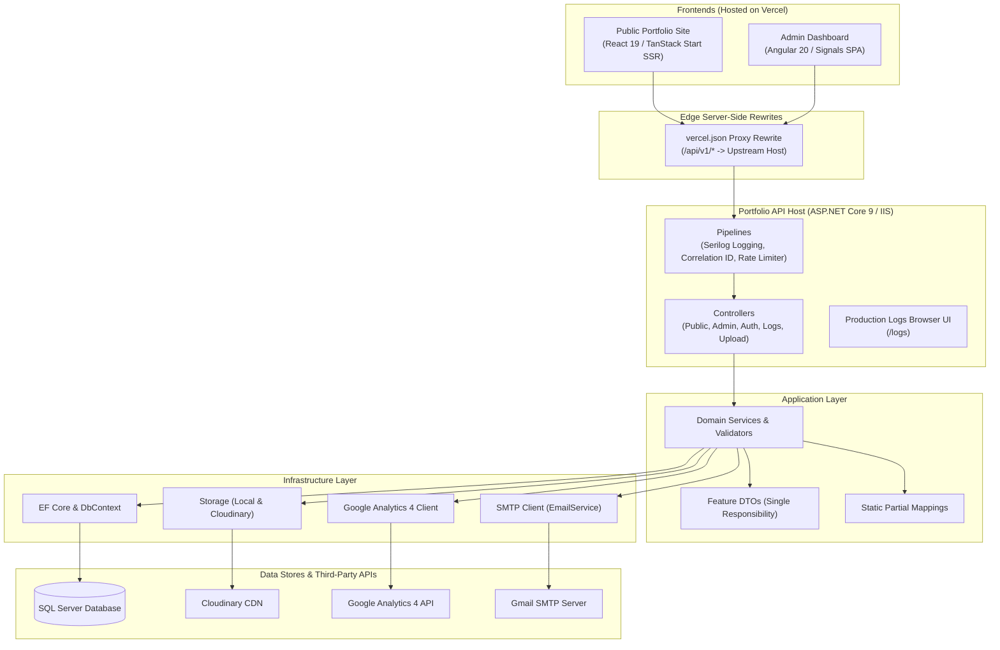

# System Architecture & Technical Design

This document details the architectural topology, data flow, edge proxying, and Clean Architecture layer boundaries of the Portfolio Full-Stack Ecosystem.

---

## 1. High-Level Architecture Topology



---

## 2. Edge Proxy & Cross-Origin Communication

Both frontends run under separate custom domains on Vercel:
- Public Site: `https://portfolio-market.vercel.app`
- Admin Dashboard: `https://dashboard-portfolio-ms.vercel.app`
- Backend API Host: `http://portfolio-market.runasp.net`

### Reverse-Proxy Rewrites
Instead of having client browsers query the backend URL directly, both frontends define server-side reverse-proxy rules in their respective `vercel.json`:

```json
{
  "rewrites": [
    {
      "source": "/api/v1/:path*",
      "destination": "http://portfolio-market.runasp.net/api/v1/:path*"
    }
  ]
}
```

### Key Advantages:
1. **Zero CORS Issues**: Browser requests are dispatched to the same origin (`/api/v1/...`), eliminating preflight `OPTIONS` round-trips and cross-origin blocking.
2. **Mixed-Content Prevention**: Vercel serves the frontend over HTTPS and handles TLS termination, securely relaying requests upstream.
3. **No Stale Fallbacks**: Frontends do not fall back to bundled mock fixtures if the backend is unavailable; intentional error states and 404 boundaries ensure truthful data presentation.

---

## 3. Clean Architecture Layer Responsibilities

The backend follows the principles of Clean Architecture and Domain-Driven Design (DDD):

```text
                  +-----------------------------------+
                  |      PortfolioAPI (Web Host)      |
                  |  Controllers, Middleware, Program |
                  +-----------------+-----------------+
                                    |
                                    v
                  +-----------------------------------+
                  |      Application Layer            |
                  |  Interfaces, Services, DTOs       |
                  +-----------------+-----------------+
                                    |
                                    v
                  +-----------------------------------+
                  |         Core / Domain Layer       |
                  |  Entities, Repository Contracts   |
                  +-----------------+-----------------+
                                    ^
                                    |
                  +-----------------+-----------------+
                  |      Infrastructure Layer         |
                  |  EF Core, SQL Server, SMTP, GA4   |
                  +-----------------------------------+
```

### 1. `PortfolioAPI.Core` (Domain Core)
- Completely independent of external frameworks and third-party libraries.
- Contains domain entities (`Project`, `Skill`, `Experience`, `ContactMessage`, `Website`, etc.).
- Defines core repository interfaces (`IRepository<T>`, `IUnitOfWork`).
- Provides domain result objects and custom exceptions.

### 2. `PortfolioAPI.Application` (Use Cases)
- Orchestrates business workflows and domain operations.
- **Single Responsibility DTOs**: Each operation uses an isolated DTO (e.g., `CreateProjectDto`, `UpdateProjectDto`, `ProjectResponseDto`) to prevent over-posting and leakage.
- **Static Partial Mappings**: High-performance explicit mapping extensions (no AutoMapper reflection overhead).
- **Validation**: FluentValidation rules guarding incoming data contracts.

### 3. `PortfolioAPI.Infrastructure` (Data & External Integrations)
- Implements repository interfaces using **Entity Framework Core 9**.
- Manages relational schema migrations for **SQL Server**.
- Implements external adapters:
  - `CloudinaryStorageService` / `LocalStorageService` for image processing.
  - `EmailService` for SMTP delivery.
  - `GoogleAnalyticsService` for real-time telemetry querying.

### 4. `PortfolioAPI` (Web Presentation Host)
- ASP.NET Core 9 Minimal Hosting (`Program.cs`).
- REST Controllers versioned under `/api/v1/`.
- Cross-cutting middleware:
  - W3C Trace & Serilog correlation ID logging.
  - Global unhandled exception handler with standardized RFC 7807 problem details.
  - Sliding-window and token-bucket rate limiting.
  - Interactive production logs viewer at `/logs`.

---

## 4. Frontend Ecosystem Design

### Public Portfolio (`portfolio/`)
- **Technology**: React 19, TanStack Start (SSR), Nitro server engine.
- **Styling**: Tailwind CSS with custom dark glassmorphism design tokens.
- **Rendering**: Server-side rendered with hydration for SEO performance and fast initial paint.

### Admin Dashboard (`dashboard/`)
- **Technology**: Angular 20 Standalone Components.
- **State Management**: Angular Signals (`signal`, `computed`, `effect`) for fine-grained reactivity without NgRx boilerplate.
- **Routing**: Lazy-loaded feature routes protected by `authGuard`.
- **Interceptors**: `AuthInterceptor` automatically attaches Bearer JWTs and handles 401 token refresh/redirect flows.

---

## 5. Further Reading
- [docs/BACK_STRUCTURE.md](BACK_STRUCTURE.md) — Exhaustive backend source file blueprint.
- [docs/API_SURFACE.md](API_SURFACE.md) — Endpoint specifications and schemas.
- [docs/DEPLOYMENT.md](DEPLOYMENT.md) — Production infrastructure setup.

